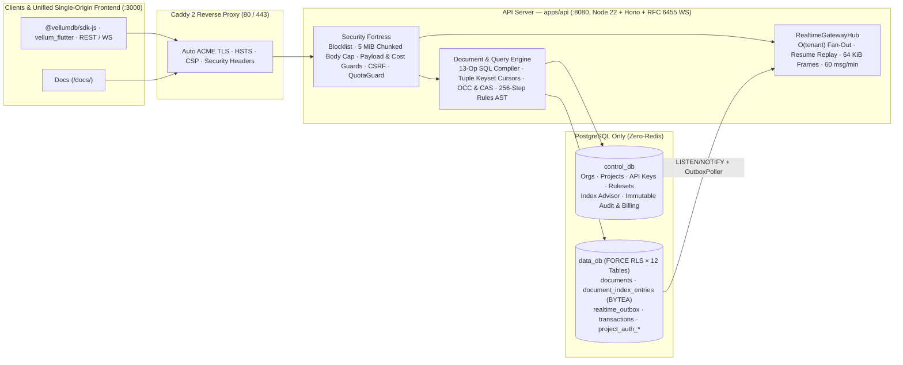

# VELLUM — PostgreSQL-Native Multi-Tenant Document Database Platform

> **Status: public beta.** The current version is in [CHANGELOG.md](./CHANGELOG.md). The project and every SDK share one version. APIs may still change before a stable release.
>
> Deployment entry point: [two-project Vercel runbook and optional adapters](./docs/deployment/README.md).

<div align="center">
  
</div>

VELLUM is a multi-tenant document database platform that runs entirely on PostgreSQL. There is no Redis and no external broker. It is built with **Node.js 22**, **TypeScript**, **Hono** and **PostgreSQL**, and ships a REST + WebSocket API, a bilingual (EN/AR) docs site, and official JavaScript/TypeScript and Flutter/Dart SDKs.

It provides hierarchical collections, typed JSONB documents, a 13-operator parameterized SQL query compiler, order-preserving composite indexes, optimistic-concurrency transactions, declarative security rules, isolated Ed25519 end-user authentication, and native RFC 6455 realtime WebSockets.

---

## Why Vellum

| Capability | Engineering Guarantee |
| :--- | :--- |
| **PostgreSQL-Only (Zero-Redis)** | PostgreSQL is the **only** stateful runtime dependency. Realtime streaming uses `LISTEN/NOTIFY` + a durable `realtime_outbox` poller; cross-instance cache invalidation uses `NOTIFY vellum_cache_invalidate`; metadata/API-key/quota caches are bounded in-process LRU/TTL maps. |
| **Dual-Plane Isolation** | Control Plane (`control_db`) and Data Plane (`data_db`) are strictly decoupled. Booting, verifying API keys, and enforcing quotas never depend on the Data Plane. |
| **Fail-Closed RLS on 12 Tables** | Every Data Plane table enforces `ENABLE` + `FORCE ROW LEVEL SECURITY` keyed on transaction-local `app.current_project_id` bound in a **single round-trip** (`set_config(..., true)`), with nested `SAVEPOINT`s and automatic `40001`/`40P01` retries. |
| **13-Operator SQL Compiler** | All 13 operators (`==`, `!=`, `<`, `<=`, `>`, `>=`, `in`, `not-in`, `array-contains`, `array-contains-any`, `contains_ci`, `starts_with_ci`, `text_search`) + `or` groups compile to 100% parameterized SQL with row-value tuple keyset pagination and HMAC-SHA256 cursors. |
| **Zero-DDL Composite Indexes** | Order-preserving `sort_key BYTEA` entries in `document_index_entries` power multi-field composite range/sort scans via a commutative cost-ranked index matcher and proactive E→S→R Smart Index Advisor—no per-tenant `CREATE INDEX` locks. |
| **Security Fortress** | Isolated **Ed25519** `project_end_user` tokens; universal `crypto.timingSafeEqual`; `256`-step Rules AST CPU budgets; SSRF/CSRF/payload/query-cost guards; and spoof-resistant `TRUST_PROXY_HOPS` IP extraction. |
| **Hardened Production Runtime** | Non-root `node:22-alpine` containers with `/sbin/tini`, `read_only: true`, `cap_drop: [ALL]`, loopback-only ports behind Caddy 2 ACME TLS, coalesced `/health` & `/ready` probes, and graceful `SIGTERM`/`SIGINT` draining (`1001 Going Away`). |

---

## System Architecture



---

## Quick Start

### Prerequisites
- **Node.js `>= 22.0.0`** (`corepack pnpm check:node`)
- **pnpm** (via Corepack; the repo is pinned through `pnpm-lock.yaml`)
- **PostgreSQL 16+** (two databases: `control_db` and `data_db`) or **Neon Serverless PostgreSQL**. Unit tests run without a database.
- Docker, optional, to start local PostgreSQL from `docker/docker-compose.yml`

### 1. Install, Configure & Run Locally

```bash
# Install dependencies
corepack pnpm install

# Start local PostgreSQL (control_db on 127.0.0.1:5432, data_db on 127.0.0.1:5433)
docker compose -f docker/docker-compose.yml up -d

# Copy environment template and verify configuration
# (the defaults in .env.example match the compose databases above)
cp .env.example .env
corepack pnpm dev:env-check

# Run checksum-verified Control Plane + Data Plane migrations
corepack pnpm db:migrate

# Build everything, then start the API and the static frontend gateway
corepack pnpm build
corepack pnpm dev:stack
```

`dev:stack` serves two local URLs. It does not build anything, so run the build first:

- `http://localhost:3000`: Docs (`/docs/`, `/docs/ar/`). The gateway proxies `/v1` to the local API. This proxy is a local convenience only; deployed frontends call the API by its absolute URL.
- `http://localhost:8080`: the API, including the WebSocket endpoint at `/v1/realtime`.

Run one side alone with `corepack pnpm dev:backend` (API) or `corepack pnpm dev:frontend` (frontend). Key environment variables are documented in `.env.example` (database URLs, `API_PORT`, `JWT_SECRET`, `CURSOR_HMAC_SECRET`, `API_KEY_PEPPER`, `CORS_ALLOWED_ORIGINS`, `VITE_API_BASE_URL`).

### 2. Deploy

The primary path is two independent Vercel projects: the backend (`vellum-api`) and the static frontend (`vellum-console`). See [DEPLOYMENT-SPLIT.md](./docs/DEPLOYMENT-SPLIT.md).

Self-hosting with hardened Docker Compose and Caddy is an alternative:

```bash
# Requires .env with NODE_ENV=production, DATABASE_MODE=postgres,
# and external PostgreSQL URLs.
VELLUM_DOMAIN=example.com docker compose -f deploy/docker/docker-compose.prod.yml up -d --build
```

Verify liveness and readiness:

```bash
curl -s http://127.0.0.1:8080/health          # Fast event-loop liveness (never touches PG)
curl -s http://127.0.0.1:8080/ready           # Coalesced 3 s PG readiness (503 when draining)
curl -s http://127.0.0.1:8080/v1/health/ready # Full control/data/migrations/LISTEN probe
```

---

## Query Engine, Performance & Limits

Every query compiles in `packages/query-engine/src/compiler.ts` to parameterized SQL with native `timestamptz` / `document_id` B-Tree filters, GIN `jsonb_path_ops` pre-filtering + exact structural JSONB equality, commutative cost-ranked composite index selection, and row-value tuple keyset pagination `(ie.sort_key, ie.document_id) > ($k::bytea, $id)`.

| Limit | Value | Scope |
| :--- | --: | :--- |
| Max document size | `1 MiB` (`1,048,576` B) | Single document payload |
| Max batch / raw body | `5 MiB` (`5,242,880` B) | Up to `100` atomic batch operations (enforced on chunked streams too) |
| Query `where` / `or` groups | `10` clauses / `10` groups | Compiler limit (`MAX_DISJUNCTIVE_VALUES = 30`, `MAX_TOTAL_DISJUNCTIVE_EXPANSIONS = 120`) |
| Query `select` / field depth | `50` fields / depth `16` | `MAX_SELECT_FIELDS = 50`, `MAX_FIELD_DEPTH = 16` |
| Text filter / cursor size | `1,024` chars / `16,384` B | `MAX_TEXT_FILTER_LENGTH`, `MAX_CURSOR_TOKEN_BYTES` |
| Unindexed scan safety cap | `1,000` rows | `UNINDEXED_SCAN_CAP` (never silently truncates) |
| Query `limit` / timeout | `1..500` (default `50`) / `5,000 ms` | Transaction-local `statement_timeout` |
| Security Rules AST budget | `256` steps · depth `10` · `100` nodes | Fail-closed CPU DoS protection (`packages/authorization/src/rules-ast.ts`) |
| Realtime WebSocket caps | `64 KiB` frame · `25` subs · `60` msg/min | `1 MiB` outbound buffer, `5 s` auth timeout, `30 s` heartbeat/idle, `1008` policy close |

---

## Monorepo Layout

| Path | Description |
| :--- | :--- |
| `apps/api` | Hono HTTP REST API, native RFC 6455 WebSocket server, Zod fail-fast config, health/readiness probes, and maintenance workers |
| `apps/docs` | Bilingual (EN/AR) React Developer Documentation SPA (`/docs/`, `/docs/ar/`) |
| `packages/core` | Path parser, tagged wire format (`$t`/`$op`), binary sort-key encoder, E→S→R index advisor, `SYSTEM_LIMITS` |
| `packages/query-engine` | 13-operator SQL compiler, commutative composite index matcher, tuple keyset pagination, HMAC-SHA256 cursor codec |
| `packages/document-engine` | CRUD, atomic `$op` transforms, batched `.include()` relations, OCC transactions, 24 h idempotency, circuit breakers |
| `packages/storage` | `PgStorageAdapter`, `NeonStorageAdapter`, `MemoryStorageAdapter`, `SAVEPOINT`/retry `tx-context.ts`, `UNNEST` batches, LRU/TTL caches |
| `packages/database-control` & `database-data` | Control Plane & Data Plane migrations (`0001`–`0013` in each), checksum-verified runner, hardened `rls.ts` (12 tables) |
| `packages/auth`, `authorization`, `security` | End-user auth (Ed25519 JWTs), `pk_`/`sk_` keys, Rules AST/DSL, Fortress guards |
| `packages/realtime` | `RealtimeGatewayHub`, `OutboxPoller`, and PostgreSQL `LISTEN/NOTIFY` bus |
| `packages/api-contract`, `observability` | Generated OpenAPI contract and shared API types; logging and tracing hooks |
| `packages/ui` | `@vellum/ui`, the shared React design system used by the frontend apps |
| `packages/sdk-js` & `sdks/flutter` | Official TypeScript/JavaScript (`@vellumdb/sdk-js`) and Flutter/Dart (`vellum_flutter`) SDKs |
| `examples/` | Runnable TS, REST and Dart examples plus live testbed apps (see [examples/README.md](./examples/README.md)) |
| `tests/` | Contract, security, integration, Playwright e2e, real-HTTP/PostgreSQL e2e, load and Dart verification suites |
| `deploy/` | Hardened `docker-compose.prod.yml`, `Dockerfile.api`, `Dockerfile.frontend`, `Caddyfile`, Railway, Render, Vercel, Cloudflare |

---

## Verification & Quality Gates

```bash
corepack pnpm verify          # Typecheck + ESLint + full unit test suite
corepack pnpm test:security   # RLS isolation, credential-isolation 403s, SSRF, CSRF, AST budgets
corepack pnpm test:integration # PostgreSQL integration tests
corepack pnpm codegen:check   # OpenAPI and Dart error-code artifacts are up to date
corepack pnpm version:check   # Project and SDK versions are aligned
corepack pnpm test:e2e        # Playwright browser tests (frontend apps)
corepack pnpm docs:verify     # Run docs examples and build the docs site
corepack pnpm smoke           # Live HTTP + PostgreSQL smoke verification
cd sdks/flutter && dart pub get && dart analyze --fatal-infos && dart test   # Flutter/Dart SDK
corepack pnpm bench           # Micro-benchmarks (mitata)
corepack pnpm bench:explain   # EXPLAIN (ANALYZE, BUFFERS) plan-regression checks
corepack pnpm test:load       # k6 concurrent throughput & p50/p95/p99 latency suite
```

CI (`.github/workflows/ci.yml`) runs the build, codegen and version checks, typecheck, lint, unit and security tests, the Dart SDK checks, independent backend and frontend builds, the split-boundary check, and PostgreSQL integration tests. Browser tests run in `e2e.yml`.

---

## Documentation Hub

Browse the engineering documentation in [`docs/INDEX.md`](./docs/INDEX.md):

- **Core Architecture:** [01 — System Architecture](./docs/01-architecture.md) · [02 — Wire Format & Paths](./docs/02-wire-format-and-paths.md) · [Data Plane RLS (12 Tables)](./docs/data-plane-rls.md)
- **Querying & Performance:** [03 — Query Compiler & Sort Keys](./docs/03-query-and-indexing.md) · [12 — Relationships & Advanced Queries](./docs/12-relationships-and-advanced-queries.md) · [14 — Smart Indexing & Performance](./docs/14-smart-indexing-and-performance.md)
- **APIs & SDKs:** [05 — HTTP REST & Realtime WS Protocol](./docs/05-http-and-realtime-api.md) · [08 — JS/TS SDK Guide](./docs/08-sdk-js-guide.md) · [09 — Flutter/Dart SDK Guide](./docs/09-sdk-flutter-guide.md)
- **Security & Billing:** [04 — Security Rules AST](./docs/04-security-rules-ast.md) · [07 — End-User Auth & Three Realms](./docs/07-end-user-auth.md) · [13 — Security Rules DSL](./docs/13-security-rules-dsl.md) · [15 — Security & Defense in Depth](./docs/15-security-and-defense.md) · [16 — Metering & Billing](./docs/16-metering-and-billing.md)
- **Deployment & Ops:** [06 — Deployment, Hardened Containers & Probes](./docs/06-deployment-and-operations.md) · [11 — Hosting Guide](./docs/11-deployment-and-hosting.md)
