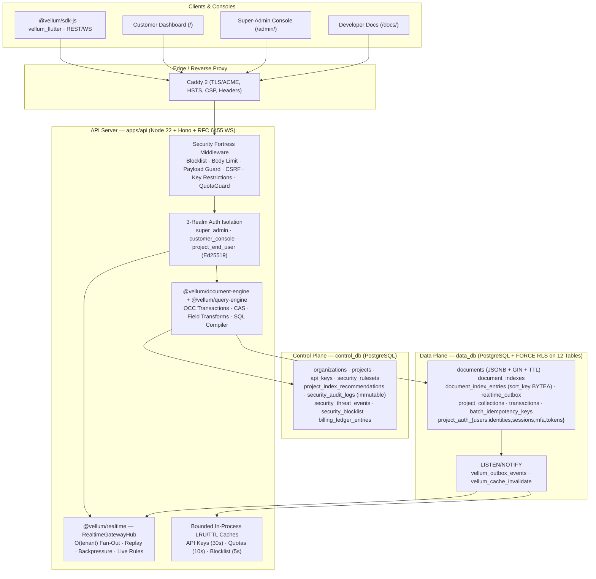

# 01 — System Architecture & Dual Data-Plane Design

> **Scope:** Authoritative architectural reference for the VELLUM multi-tenant document database platform.  
> **Grounded in:** `apps/api/src/`, `packages/database-control/`, `packages/database-data/`, `packages/storage/`, `packages/realtime/`, `packages/document-engine/`.

VELLUM is a multi-tenant, PostgreSQL-native document database service engineered for predictable latency, cryptographic tenant isolation, and zero external state dependencies. Clients interact with hierarchical collections, typed JSON documents, structured queries, atomic field transforms, optimistic concurrency transactions, and realtime WebSocket streams—all backed solely by PostgreSQL.

---

## 1. Core Architectural Doctrines

| Doctrine | Implementation Guarantee |
| :--- | :--- |
| **PostgreSQL-Only (Zero-Redis)** | PostgreSQL is the **only** stateful runtime dependency. There is no Redis, Kafka, NATS, or external lock/cache service anywhere in the stack. Realtime fan-out uses PostgreSQL `LISTEN/NOTIFY` + a durable `realtime_outbox` poller; cross-instance cache invalidation uses `NOTIFY vellum_cache_invalidate`; rate limits and metadata caches are bounded in-process LRU/TTL structures. |
| **Project-Only Multi-Tenancy** | The **project** (`project_id` UUID) is the sole tenant and isolation boundary across every API route, API key (`pk_`/`sk_`), security ruleset, and PostgreSQL Row-Level Security (RLS) policy. There is no environment hierarchy. |
| **Dual-Plane Bootstrap Safety** | Control Plane (`control_db`) and Document Data Plane (`data_db`) are strictly separated. Booting the API, authenticating operators, verifying API keys, evaluating quotas, and recovering from an outage **never** depend on the Data Plane. |
| **Defense-in-Depth Isolation** | Every Data Plane query runs inside a tenant-bound transaction with both application-layer `project_id = $1::uuid` predicates and PostgreSQL `FORCE ROW LEVEL SECURITY` policies keyed on transaction-local `app.current_project_id`. |
| **Single-Origin Unified Frontend** | In production and local dev (`corepack pnpm dev:stack`), Caddy or the unified frontend gateway serves the Customer Dashboard (`/`), Super-Admin Console (`/admin/`), bilingual Developer Docs (`/docs/`, `/docs/ar/`), and API/WebSocket proxy (`/v1/*`) cleanly without cross-realm storage collisions. |

---

## 2. High-Level System Topology



---

## 3. Dual Data-Plane Separation

### 3.1 Control Plane (`control_db`)
Managed by `packages/database-control` (11 ordered, checksum-verified migrations: `0001_init_control_plane.sql` through `0011_drop_environments.sql`):

- **Tenancy & Access:** Organizations, projects, memberships, feature flags, and three-realm session/MFA records.
- **API Keys & Rules:** `api_keys` (16-char `key_prefix` + salted/peppered SHA-256 `secret_hash`, `allowed_origins`, `allowed_ips`, `expires_at`, `revoked_at`) and versioned `security_rulesets` (compiled JSON AST + optional V2 DSL source).
- **Smart Indexing Advisor:** `project_index_recommendations` storing deduplicated query fingerprints, hit counts, latency stats, and one-click apply/dismiss states.
- **Security Fortress & Billing:** Append-only `security_audit_logs` and `billing_ledger_entries` protected by PostgreSQL `BEFORE UPDATE OR DELETE` immutability triggers (`prevent_immutable_table_mutation()`) and HKDF-derived HMAC-SHA256 hash chains, plus `security_threat_events`, `security_blocklist`, and usage/invoice tables.

### 3.2 Document Data Plane (`data_db`)
Managed by `packages/database-data` and `packages/storage` (11 ordered migrations: `0001_init_data_plane.sql` through `0011_drop_environments.sql`):

- **`documents`:** Tagged `JSONB` payloads (`size_bytes <= 1 MiB`), `path_depth` (`2..10` even), monotonic `version`, soft-delete tombstones (`deleted_at`), and per-document TTL (`expires_at`).
- **`document_indexes` & `document_index_entries`:** Multi-tenant composite index definitions (`building | ready | failed | deleting`) and order-preserving binary sort keys (`sort_key BYTEA`) indexed by `PRIMARY KEY (index_id, sort_key, document_id)`—zero per-tenant `CREATE INDEX` DDL.
- **`realtime_outbox`:** Monotonically sequenced mutation log (`seq_id BIGSERIAL`) written inside the exact same ACID transaction as every document mutation.
- **Transactional & Collection State:** `project_collections`, `transactions` (durable OCC state), and `batch_idempotency_keys` (24-hour idempotency replay ledger).
- **Project End-User Auth Tables:** `project_auth_users`, `project_auth_identities`, `project_auth_sessions`, `project_auth_mfa`, and `project_auth_tokens`—isolated per project under the exact same RLS boundary.

---

## 4. Hardened PostgreSQL Transaction Lifecycle

Every Data Plane operation runs through `packages/storage/src/tx-context.ts` and `packages/database-data/src/rls.ts`:

```text
Request ──▶ Validate projectId UUID (fail-fast before pool checkout)
        ──▶ Check AsyncLocalStorage activeTxStorage:
              ├─ Same pool & same projectId ──▶ SAVEPOINT vellum_sp_N (re-entrant)
              ├─ Same pool & different projectId ──▶ THROW PERMISSION_DENIED (fail-closed)
              └─ Top-level transaction ──▶ Acquire pooled client
        ──▶ Bind transaction-local GUCs in 1 round-trip:
              • pg (preparedStatements: true):
                BEGIN; SET LOCAL statement_timeout = '5000ms';
                SET LOCAL search_path = public;
                SELECT set_config('app.current_project_id', '<uuid>', true);
              • Neon / parameterized path (rls.ts):
                SELECT set_config('app.current_project_id', $1, true),
                       set_config('statement_timeout', '5000ms', true),
                       set_config('lock_timeout', '2000ms', true),
                       set_config('idle_in_transaction_session_timeout', '15000ms', true);
        ──▶ Execute parameterized / UNNEST-batched SQL under FORCE RLS
        ──▶ COMMIT (or ROLLBACK; if ROLLBACK fails, client.release(err) destroys socket)
        ──▶ Retry top-level tx up to 3x with jitter on PG 40001 / 40P01
```

### Key Storage Engine Optimizations
- **Single-Round-Trip Tenant Binding:** Collapses session/timeout/search_path/RLS setup into a single round-trip with strictly transaction-local `set_config(..., true)` (Neon and PgBouncer transaction-pooling safe).
- **Nested `SAVEPOINT` Transactions:** `AsyncLocalStorage` tracks active transaction frames so nested calls on the same pool and tenant reuse the connection via `SAVEPOINT vellum_sp_N` / `RELEASE SAVEPOINT` / `ROLLBACK TO SAVEPOINT`, while nested cross-tenant calls fail closed immediately.
- **Transient Serialization & Deadlock Retries:** Top-level transactions automatically retry PostgreSQL `40001` (`serialization_failure`) and `40P01` (`deadlock_detected`) up to `maxRetries = 3` with jittered backoff (`retryBaseDelayMs = 15`).
- **Batched `UNNEST` Writes & Atomic CTEs:** Multi-document upserts (`SQL_INSERT_DOCUMENTS_UNNEST`), compare-and-swap flushes (`SQL_CONDITIONAL_PUT_DOCUMENTS_UNNEST`), composite index entry writes (`SQL_INSERT_INDEX_ENTRIES`), and outbox appends (`SQL_INSERT_OUTBOX_UNNEST`) execute in single-statement `UNNEST` batches. Collection clears and deletions use atomic `WITH deleted AS (DELETE FROM documents ... RETURNING size_bytes)` CTEs to eliminate `SELECT`-then-`DELETE` races and halve table scans.
- **Tainted Connection Destruction:** If `ROLLBACK` fails on a pooled client, the error is passed to `client.release(destroyError)` so the pool destroys the socket rather than returning a potentially dirty connection to another tenant.

---

## 5. Monorepo Package Architecture

| Workspace | Responsibility |
| :--- | :--- |
| `apps/api` | Hono HTTP API + native RFC 6455 WebSocket server (`node-server.ts`, `ws-rfc6455.ts`), Zod fail-fast config (`config.ts`), health/readiness probes (`routes/health.ts`), and maintenance workers. |
| `apps/dashboard` | Customer Console SPA (served at `/`). |
| `apps/admin` | Super-Admin Operations SPA (served at `/admin/`). |
| `apps/docs` | Bilingual (EN/AR) Developer Documentation SPA (served at `/docs/` and `/docs/ar/`). |
| `packages/core` | Canonical path parser, tagged wire format (`$t`/`$op`), order-preserving `sort_key BYTEA` encoder, E→S→R index advisor, `SYSTEM_LIMITS`, and canonical `VellumError` codes. |
| `packages/query-engine` | 13-operator SQL compiler, commutative cost-ranked composite index matcher, row-value tuple keyset pagination, and HMAC-SHA256 cursor codec. |
| `packages/document-engine` | Document CRUD, atomic field transforms, batched `.include()` relations, OCC transaction manager, idempotency ledger, and circuit breakers. |
| `packages/storage` | `PgStorageAdapter`, `NeonStorageAdapter`, `MemoryStorageAdapter`, `tx-context.ts`, native SQL aggregates, and bounded LRU/TTL caches with `NOTIFY` invalidation. |
| `packages/database-control` | Control Plane migrations (`0001`–`0011`), checksum-verified migration runner, and store implementations. |
| `packages/database-data` | Data Plane migrations (`0001`–`0011`), `INIT_DATA_PLANE_SQL`, and hardened `rls.ts` helpers. |
| `packages/auth` | Three-realm session isolation, Ed25519 end-user JWTs, password hashing, MFA, and auth projector. |
| `packages/authorization` | Constant-time `pk_`/`sk_` API key verifier, security rules AST evaluator (`256`-step budget), and V2 Rules DSL compiler/decompiler. |
| `packages/realtime` | `RealtimeGatewayHub`, `OutboxPoller`, and `PgNotifyBus` (`LISTEN/NOTIFY` bridge). |
| `packages/security` | Security Fortress guards: payload guard, query-cost guard, SSRF guard, CSRF/headers, threat detector, and HKDF HMAC-SHA256 hash chain. |
| `packages/billing` | O(1) in-memory metering, `QuotaGuard`, double-entry billing ledger, and Stripe webhook verifier. |
| `packages/sdk-js` & `sdks/flutter` | Official TypeScript/JavaScript (`@vellum/sdk-js`) and Flutter/Dart (`vellum_flutter`) client SDKs. |

---

## Related Guides

- [02 — Canonical Document Paths & Tagged Wire Format](./02-wire-format-and-paths.md)
- [03 — Query Compiler, Order-Preserving Sort Keys & Cursor Pagination](./03-query-and-indexing.md)
- [Data Plane Row-Level Security (RLS) & Multi-Tenant Isolation](./data-plane-rls.md)
- [14 — Smart Indexing & Performance](./14-smart-indexing-and-performance.md)
- [15 — Security, Threat Detection & Defense in Depth](./15-security-and-defense.md)
