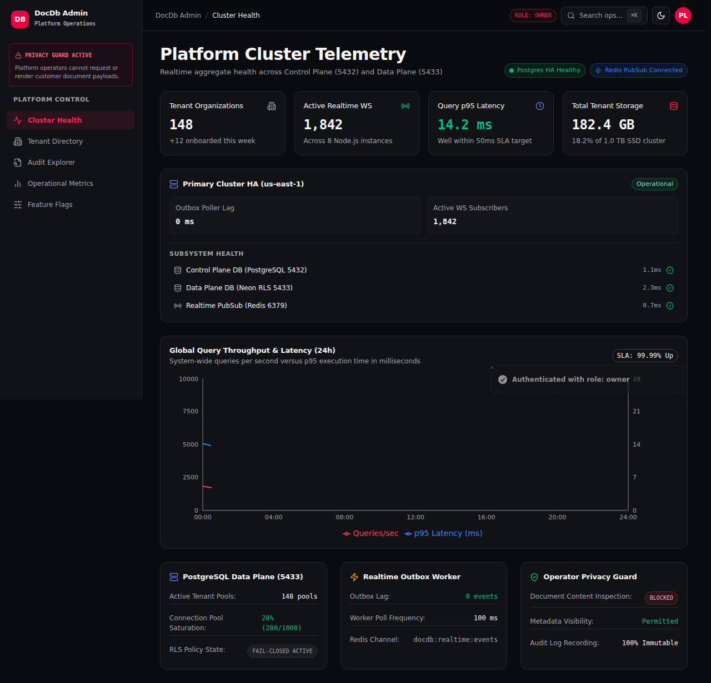
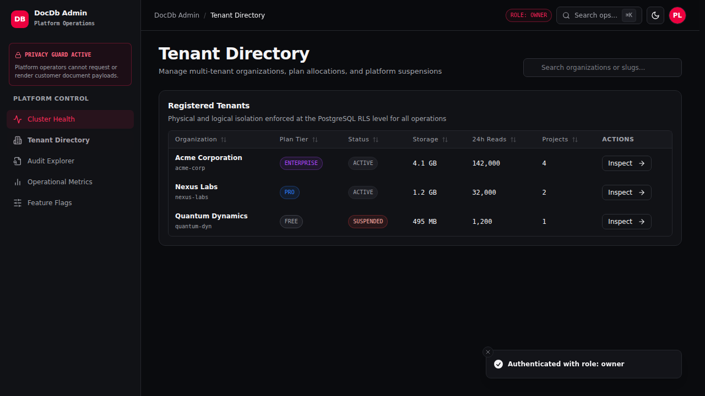

# Platform Owner Admin Dashboard — Operator Guide

## 1. Overview & Privacy Invariant

The VELLUM Admin Console (`apps/admin`) is restricted to internal platform operators with `platformRole IN ('owner', 'admin', 'support_readonly')`.

> [!IMPORTANT]
> **Strict Privacy Invariant:**
> Platform administrators can inspect cluster health, tenant metadata, quotas, index health, and audit logs, but can **NEVER** view or render customer `documents.data` payloads.

---

## 2. Core Operator Workflows

### 2.1 Cluster Health Telemetry (`/admin`)
- Realtime health cards: Active Tenant Pools, WS Connections, p95 Query Latency, and Storage Saturation.
- Realtime graphs tracking queries per second and p95 latency against the 50ms SLA target.
- Database node status for Control Plane (5432) and Data Plane (5433).

### 2.2 Tenant Directory (`/admin/tenants`)
- Filter and search all organizations by name, slug, or billing email.
- Inspect tenant plan tier (`free`, `pro`, `enterprise`), storage consumed, and 24h operation volume.

### 2.3 Tenant Quotas & Suspension (`/admin/tenants/:orgId`)
- View tenant organization metadata.
- Apply custom daily read/write limits and storage quota overrides.
- Suspend tenant access: Reversible fail-closed killswitch immediately revoking tenant data plane operations with `403 Forbidden`.

### 2.4 Immutable Audit Explorer (`/admin/audit`)
- Search platform mutations by actor user ID, target organization, or action name.
- View structured JSON metadata payloads with `JsonViewer`.

### 2.5 Feature Flags Management (`/admin/features`)
- Dynamically toggle system capabilities (Vector Search, JIT Query Optimization, Geo Queries) without application restarts.
- Adjust progressive percentage rollouts from 0% to 100%.

---

## 3. Visual Verification & Production Screenshots

The following operator screenshots illustrate actual visual rendering with Tailwind CSS 4 design tokens:

- **Cluster Health & Telemetry (`/admin`):**  
  
- **Tenant Directory (`/admin/tenants`):**  
  

