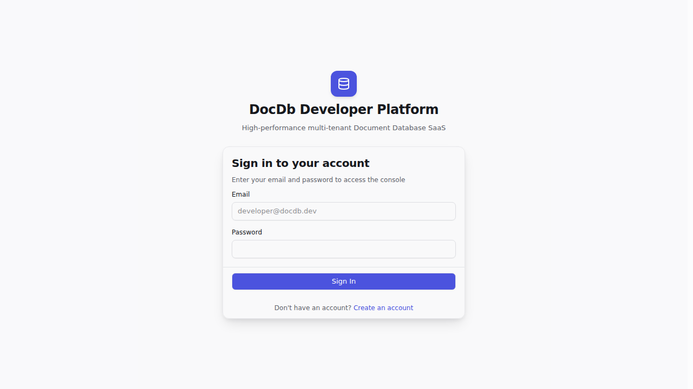
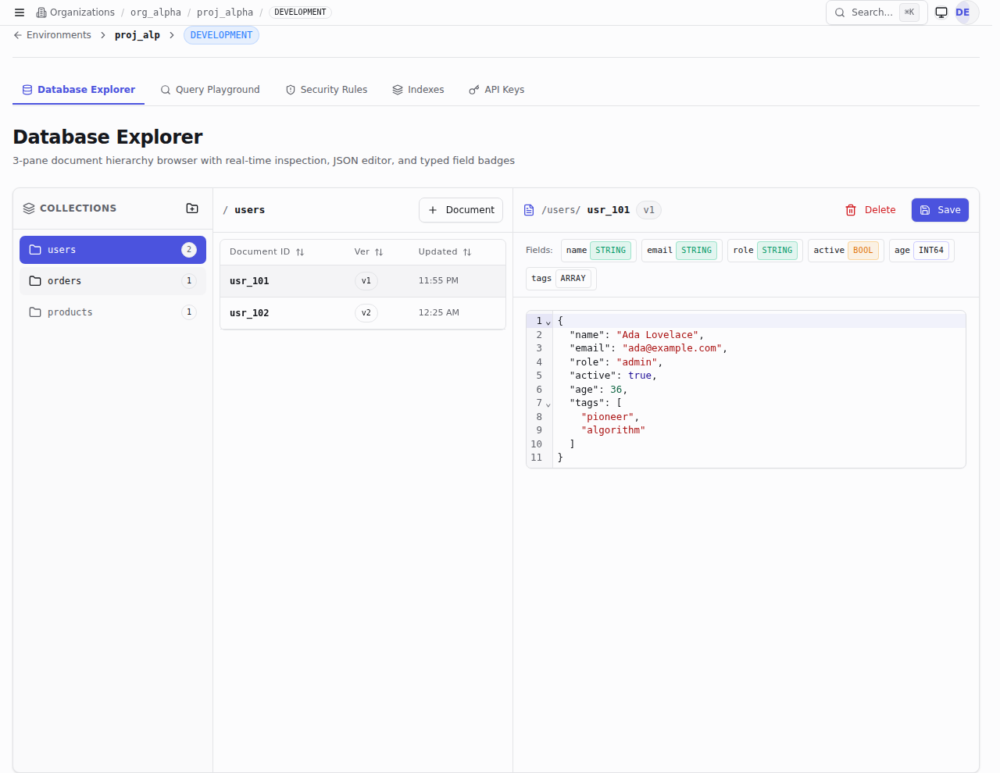
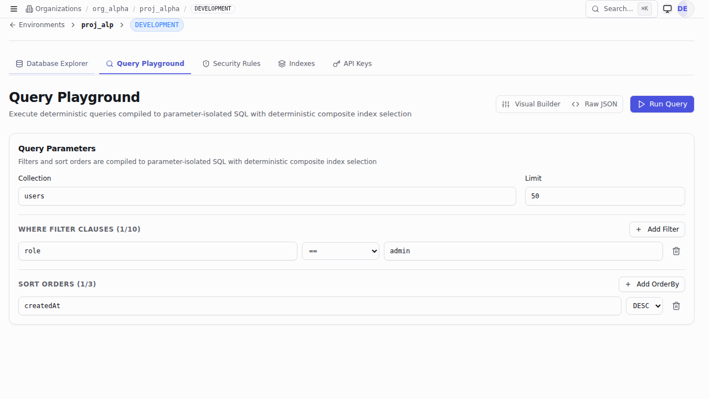
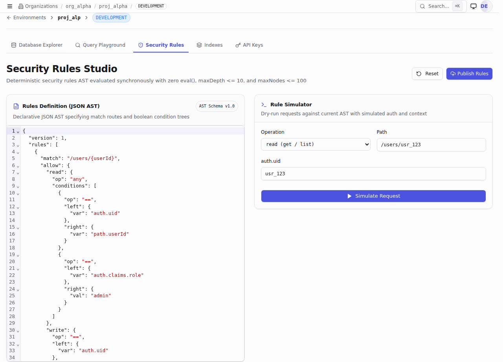
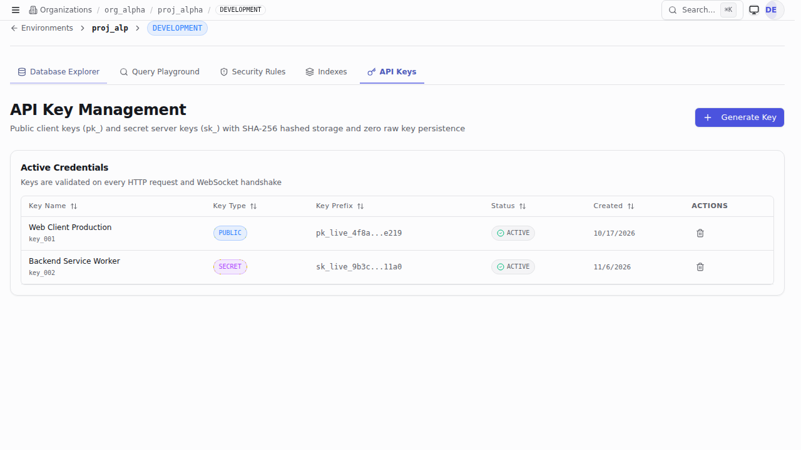

# Customer Developer Dashboard — User Guide

## 1. Overview

The VELLUM Customer Developer Dashboard (`apps/dashboard`) is the central management portal for software engineers and teams building applications on VELLUM. It provides full control over organizations, each project, database documents, queries, declarative security rules, composite indexes, and API keys.

---

## 2. Organization & Project Navigation

1. **Organization Hierarchy:**
   - Multi-tenant organizations group projects and billing limits.
   - Access is scoped via Better Auth sessions.
   - The project is the sole tenant, isolated with strict PostgreSQL RLS policies.

---

## 3. Subsystem Guides

### 3.1 3-Pane Database Explorer
Located under `/app/orgs/:orgId/projects/:projectId/data`:
- **Pane 1 (Collections Tree):** Root-level collections (e.g. `/users`, `/orders`). Create collections with the `+` button.
- **Pane 2 (Documents DataGrid):** Paginated table of document IDs, versions, and update timestamps. Select any document to open the inspector.
- **Pane 3 (Document Inspector):**
  - Displays document ID, version tag (`v1`, `v2`), and wire type tags for each field.
  - Interactive JSON editor to update payload.
  - "Save Changes" invokes atomic update.
  - "Delete Document" removes document and sort key entries.

### 3.1a Collections lifecycle (Data Explorer sidebar)

The sidebar is backed by the session-authenticated console collection registry
(`GET /v1/console/projects/:projectId/collections?limit=500`), not by
client-only state. Collections persist across F5 and restarts — even when empty.

- **Sidebar controls:** search field, refresh button, and the `+` button
  (`button[title="Add Collection"]`) which opens the Add Collection dialog
  (`#colName`, accessible submit name `Add Collection`). The dialog also accepts
  a description, a default TTL in seconds and required field names. Count pills
  show the live document count; collections with a TTL show a badge.
- **`?collection=` URL sync:** selecting a collection writes its name into the
  `?collection=` query parameter, so a deep link or F5 restores the selection.
  On first load the first available collection is auto-selected.
- **Per-collection `…` menu:** *Settings* opens a sheet with description, default
  TTL and required fields (saved with `PATCH`); *Export* downloads the collection
  as JSON (`{ documents: […], nextCursor }`); *Import* accepts a JSON **array** of
  `{ id?, data }` objects (≤500) and reports `importedCount` / `skippedCount`;
  *Clear* soft-deletes every document but keeps the collection and its settings;
  *Delete* is type-to-confirm and removes the registration **and** all documents.
- **Shared pickers:** the Query Studio, Composite Index Manager and Security Rules
  Studio collection comboboxes now list these real registered collections, while
  still accepting a custom path (for example `#idxColl` in the Index Manager).

All console mutations are written to the hash-chained audit log; the Dashboard
uses its `CUSTOMER_CONSOLE` session token and never handles an `sk_` key.

### 3.2 Query Playground
Located under `/app/orgs/:orgId/projects/:projectId/query`:
- **Visual Builder:** Select collection, add up to 10 `where` filters (`==`, `!=`, `<`, `<=`, `>`, `>=`, `in`, `array-contains`), add up to 3 `orderBy` clauses, and set document limit.
- **Raw JSON Mode:** Edit raw query payload directly in CodeMirror.
- **Missing Index Detection:** If a query requires an inequality and sort on different fields without a supporting composite index, a direct alert with a deep-link to the Index Manager is presented.

### 3.3 Security Rules Studio
Located under `/app/orgs/:orgId/projects/:projectId/rules`:
- **Deterministic Rules AST:** Zero `eval()` in-memory rules evaluator.
- **Interactive Simulator:** Test any document path (`/users/{userId}`) and operation (`read`, `create`, `update`, `delete`) against mock `auth.uid` and `auth.claims`.
- Displays instantaneous green **ALLOW** or red **DENY** status with an evaluation trace.

### 3.4 Composite Index Manager
Located under `/app/orgs/:orgId/projects/:projectId/indexes`:
- Lists all active composite indexes maintained in `document_index_entries`.
- Zero DDL locks: indexes are populated via lexicographical binary sort keys without blocking tables.
- Create index modal accepts up to 3 fields with `ASC` or `DESC` sort order.

### 3.5 API Key Management
Located under `/app/orgs/:orgId/projects/:projectId/keys`:
- Generate scoped Public Keys (`pk_`) for client applications or Secret Keys (`sk_`) for backend services.
- "Copy Once" modal ensures secret keys are copied immediately upon generation and never stored in plaintext.

---

## 4. Visual Verification & Production Screenshots

The following production screenshots illustrate actual visual rendering with Tailwind CSS 4 design tokens:

- **Authentication Screen (`/login`):**
  
- **3-Pane Database Explorer (`/data`):**
  
- **Query Playground (`/query`):**
  
- **Security Rules Studio (`/rules`):**
  
- **API Key Management (`/keys`):**
  
